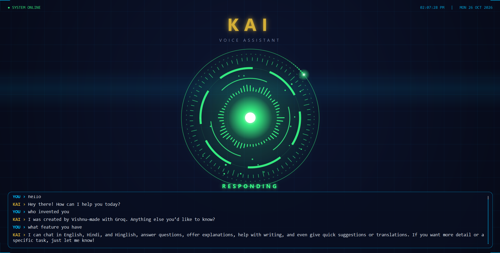

# KAI - Personal Voice Assistant



KAI is a Jarvis-inspired voice assistant for Windows, built in Python. It listens in English/Hinglish, talks back in a natural male voice, remembers past conversations, controls apps on your laptop, and comes with an animated sci-fi style GUI.

> Version: v0.1.0 | Built by Vishnu Singh

## Features

- **Voice input and output** - speak to KAI and it replies in a male Hindi-accented voice (edge-tts)
- **Smart chat** - powered by the Groq API (`openai/gpt-oss-20b`) with a friendly persona and short answers by default
- **Permanent memory** - every conversation is stored in SQLite and reloaded on startup
- **Animated GUI (PySide6)** - a rotating orb with glow, particles and equalizer bars that changes colour for Listening (blue), Processing (yellow) and Responding (green), plus a live chat log and clock
- **Open apps and sites** - Notepad, Chrome, Spotify, WhatsApp, VS Code, YouTube, Google, ChatGPT/Claude
- **Close apps** - "close chrome", "close whatsapp", etc.
- **YouTube control** - search by voice ("search X on youtube") and auto-play a video by name ("play X on youtube")
- **Scroll control** - "scroll down" / "scroll up" (Hindi and Hinglish variants also work)
- **Auto-start** - can launch with Windows and greet you on startup

## Tech Stack

| Purpose | Tool |
|---|---|
| Language | Python |
| LLM | Groq API |
| Speech to text | SpeechRecognition (Google, `en-IN`) |
| Text to speech | edge-tts (`hi-IN-MadhurNeural`) |
| GUI | PySide6 (Qt) |
| Memory | SQLite (`kai_memory.db`) |
| Automation | pyautogui, pywhatkit, webbrowser, os |
| Config | python-dotenv |

## Project Structure

```
Kai-Core/
├── kai_gui.py          # entry point - run this
├── kai.py              # KAI's brain, voice loop and commands
├── requirements.txt    # dependencies
├── .env.example        # template for your API key
├── .gitignore
└── README.md
```

`kai_memory.db` is created automatically on first run.

## Setup

1. Clone the repo
   ```
   git clone https://github.com/vishnusingh45/Kai-Core.git
   cd Kai-Core
   ```
2. Install the dependencies
   ```
   pip install -r requirements.txt
   ```
3. Get a free API key from [Groq](https://console.groq.com). Copy `.env.example` to a new file named `.env` and put your key in it:
   ```
   GROQ_API_KEY=your_key_here
   ```
   Never commit your `.env` file.
4. Run
   ```
   python kai_gui.py
   ```

## Example Commands

- "open notepad" / "notepad open"
- "play Kesariya on youtube"
- "search python tutorial on youtube"
- "scroll down"
- "close chrome"
- "quit", "exit" or "bye" to stop KAI (or press `Esc` to close the window)

Anything that is not a command goes to the AI, so you can simply talk to KAI.

## Auto-start on Windows (optional)

Create a `start_kai.bat` file that runs `python kai_gui.py` from the project folder, then place a shortcut to it in the Startup folder (press `Win + R`, type `shell:startup`).

## Known Limitations

- Speech recognition sometimes mishears words (e.g. "notepad" as "notebook")
- The YouTube tab must be focused when giving the next "play" command
- Scrolling works on whichever window is currently focused
- KAI cannot be interrupted while it is speaking
- `PyAudio` can fail to install on Windows. If so, try `pip install pipwin` and then `pipwin install pyaudio`
- Windows only

## Roadmap

- [x] Animated GUI
- [ ] Interrupt KAI mid-speech
- [ ] Better intent detection using function calling
- [ ] More app aliases for mishearing
- [ ] Full exe paths for apps like Spotify and VS Code

## Author

**Vishnu Singh** - BCA (Data Science & AI) student